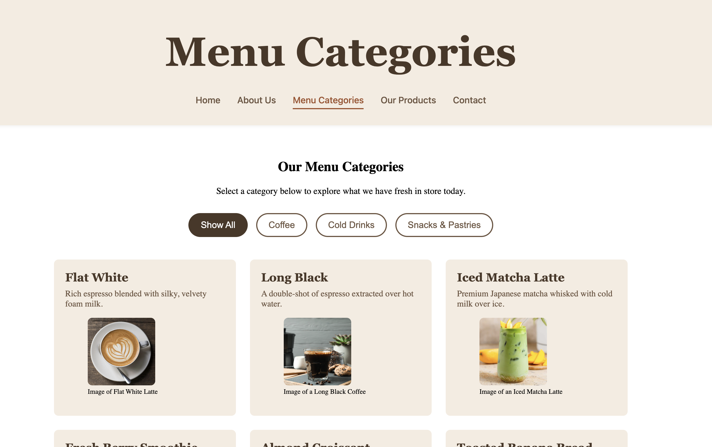

# Project 2: Cozy Corner Cafe - Front-End Web Application

## Project Overview
The **Cozy Corner Cafe** website is a fully responsive, functional front-end web application developed to promote a fictional local business cafe. Built using semantic **HTML5**, custom layout styling rules in **CSS3**, and interactive **JavaScript**, the platform showcases the cafe's unique selling points, core profile details, product menus, and itemized catalog selections.

## Key System Elements
* **Home Page (`index.html`):** Introduces the brand and highlights core unique selling points like premium sourcing and community presence.
* **About Page (`about.html`):** Outlines professional background details, values, and community milestones.
* **Category Page (`category.html`):** Organises the menu selections dynamically by groupings (Coffee, Cold Drinks, and Pastries).
* **Products Page (`products.html`):** Provides a comprehensive item catalog complete with item graphics, pricing data, and descriptions.
* **Contact Page (`contact.html`):** Displays localized touchpoints and integrates an evaluation contact form framework.

---

## Value Provided to Users
1. **Seamless Device Scaling:** Through mobile-first CSS breakpoints and fluid layouts, users can access information, search products, or send messages equally well from a desktop workstation or a smartphone viewport.
2. **Interactive Content Filtering:** The Category and Product pages eliminate allow users to toggle and sort items on-demand using JavaScript filter systems without needing painful browser refreshes.
3. **Real-Time Input Evaluation:** The contact form includes custom client-side validation loops, catching layout typos or empty submissions instantly to offer clear, interactive feedback strings.
4. **Accessible UX Architecture:** Implements a high-contrast palette schema and logical landmark structures, making cross-platform site exploration easy for screen readers and visually impaired users.

---

## Technical Features & Implementation
* **Component Encapsulation:** Code architectures are split logically into custom stylesheets (`style.css`), dynamic script handlers (`app.js`), and isolated media directories (`assets/images/`).
* **Validation Standards:** Built entirely with strict compliance standards to cleanly pass through official W3C markup, Jigsaw CSS, and JS validation linters without structural execution errors.

---

## Testing Procedures and Findings
To satisfy rigorous stability guidelines, the application underwent testing across multiple layers:

1. **Markup & Code Integrity Validation:**
   * **HTML Evaluation:** Checked via the official W3C Validator. Resolved initial self-closing tag mismatches and closed all internal structural elements.
   * **Style Validation:** Passed through the official Jigsaw CSS Validator to ensure styling properties contain correct unit values.
   * **Script Validation:** Screened script files with JavaScript linters (e.g., JSHint) to verify strict comparison assignments and eliminate structural runtime loops.
2. **Form Interaction Loops:**
   * **Test Matrix:** Submitted blank sheets, missing `@` fields, and valid user payloads. 
   * **Finding:** JavaScript successfully blocked invalid submissions, highlighted target input text elements in crimson background filters, and accurately outputted clean message blocks.
3. **Cross-Platform Responsiveness Layout Check:**
   * **Test Matrix:** Tested layouts via browser simulation tools down to a minimum configuration width of `320px`.
   * **Finding:** Vertical navigation stacking rules execute appropriately, and multi-column display cards morph cleanly into a full-width linear layout on smaller screens.

---

## Deployment Procedure
The repository is actively maintained with version control tracking tools (Git) and hosted live on the web via GitHub Pages. Follow these steps to access or review the application:

1. Open your project repository panel on GitHub and select the **'Settings'** tab.
2. Navigate down the left sidebar utility cluster to **'Pages'**.
3. Under the **'Build and deployment'** section, click the 'Source' dropdown and set it to **'Deploy from a branch'**.
4. Set your primary operational branch option to **'Main'** (or **'Master'**), keep the Root folder configuration (`/`) selected, and click **'Save'**.
5. Once the automated deployment task finishes reloading, your live server URL will appear highlighted at the top of the interface.

---

## Attributions & External Assets
* **Development Tutorials:** Core structural design patterns adapted from official documentation modules on MDN Web Docs.
* **Typography:** System fonts utilized (`Georgia`, `system-ui`, `sans-serif`) to maintain performance baselines.
* **Imagery & Media Assets:** Creative graphics and product imagery were sourced from open license stock media libraries.
